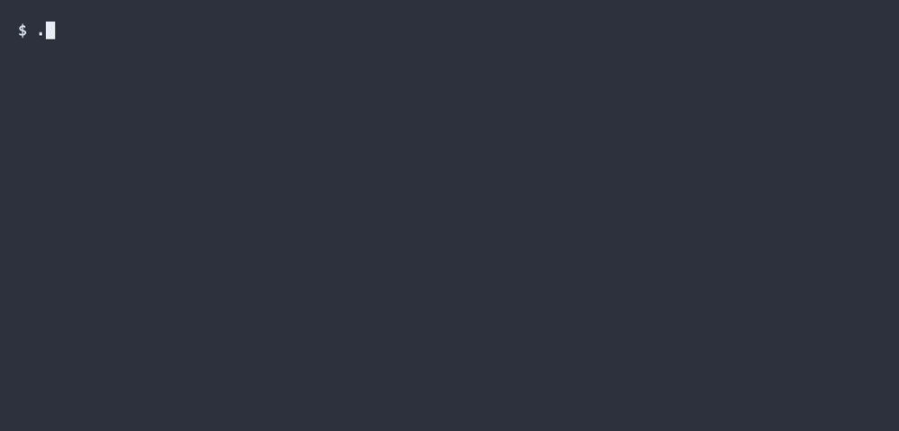
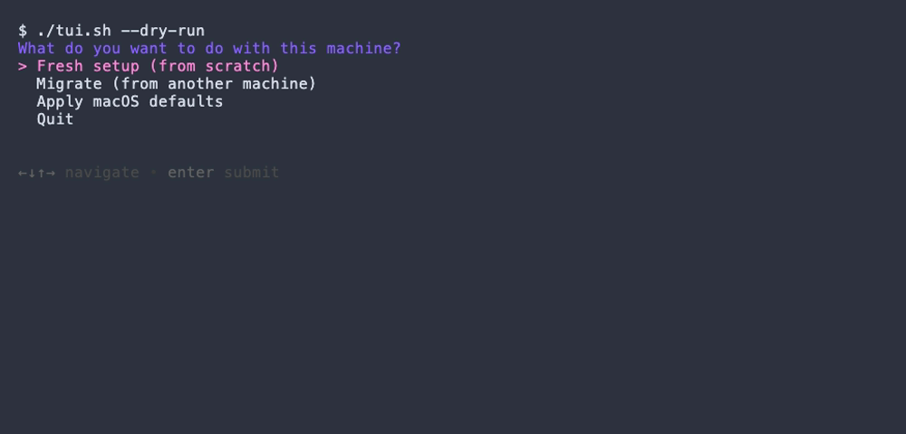
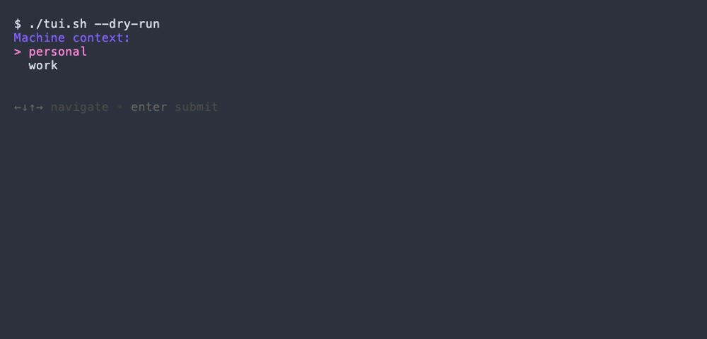
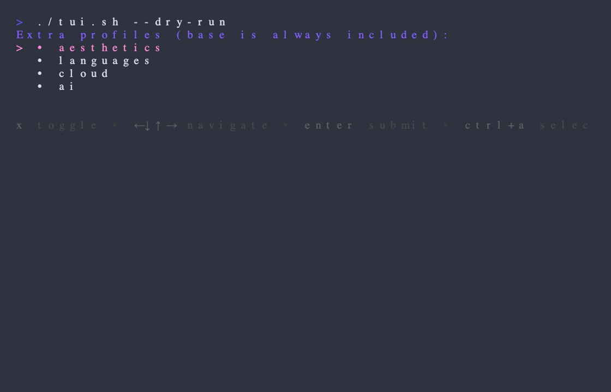
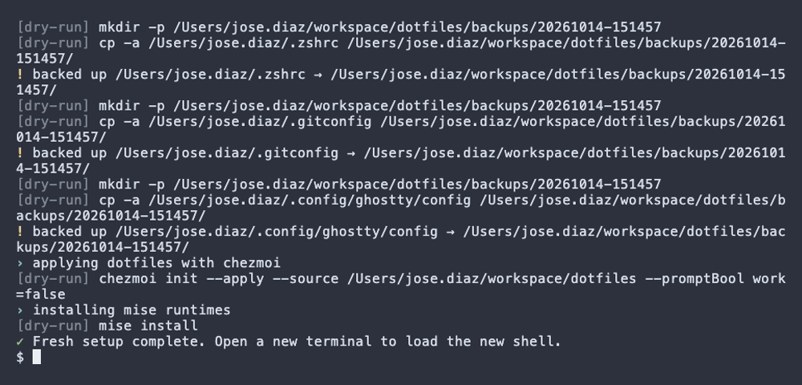

# dotfiles

My macOS setup as a small tool you can run. It does two things: set up a new Mac
from scratch, or move an existing one over to a new machine. I keep it public, so
it's written so that no secrets or work-specific config ever end up in the repo.

<p align="center">
  
</p>

## Setup

```bash
git clone https://github.com/josediego/dotfiles
cd dotfiles
./bootstrap.sh
```

`bootstrap.sh` installs what it needs (Xcode CLT, Homebrew, `gum`, `chezmoi`,
`gitleaks`, `age`), turns on the secret-scanning git hook, and opens the menu. It's a
plain `git clone`, not a `curl | bash`, so you can read it first.

If the machine is already set up, skip the bootstrap and just run `./tui.sh`.

## What the menu looks like

You pick what to do, and it shows you exactly what it's going to run before touching
anything.

<table>
  <tr>
    <td width="50%"><br><sub>Pick what to do</sub></td>
    <td width="50%"><br><sub>Work or personal</sub></td>
  </tr>
  <tr>
    <td width="50%"><br><sub>Choose profiles (base always runs)</sub></td>
    <td width="50%"><br><sub>See what it'll do first</sub></td>
  </tr>
</table>

## What it installs

- Dotfiles and secrets with [chezmoi](https://chezmoi.io). Files are templated per
  machine (work vs personal), and if you want a secret in the repo you can encrypt it
  with [age](https://age-encryption.org).
- Packages from `Brewfile`s, grouped into profiles: `base`, `aesthetics`,
  `languages`, `cloud`, `ai`. `base` always runs.
- Runtimes with [mise](https://mise.jdx.dev): node, bun, go.
- The terminal look: Ghostty with Commit Mono and the Nord colors, plus the
  `lambda-classic` zsh prompt.
- An optional set of macOS defaults (keyboard, Finder, Dock, screenshots).

## The two modes

**Fresh setup** asks for context and profiles, runs `brew bundle`, applies the
dotfiles with `chezmoi`, and installs the mise runtimes. You can re-run it; it backs
up anything it would overwrite first.

**Migrate** asks how to connect (SSH or a local drive), which way to go (pull or
push), where from, and what to copy. It runs `rsync`, shows a dry run, and waits for
you to confirm. The host and paths are typed in when you run it; nothing is stored in
the repo.

Flags: `--dry-run`, `--non-interactive`, `--work` / `--personal`, `--only "a,b"`.

## Keeping it public

The rule is just: nothing private goes in git.

- Machine-specific or secret stuff lives in `~/.zshrc.local` and `~/.gitconfig.local`,
  which are gitignored. The committed files only source them. See [`templates/`](templates/).
- If a secret does need to be in the repo, encrypt it with `age`. chezmoi commits it
  as an `*.age` file and the key stays on your machine, out of git.
- A `gitleaks` hook runs before every commit, and the same scan runs in CI. You can
  run it yourself with `make scan`.

## make

```text
make help     list targets
make lint     shellcheck the scripts
make test     bats tests
make scan     gitleaks over the whole tree
make doctor   show chezmoi drift
```

## Files

```text
bootstrap.sh            entry point
tui.sh                  the menu (fresh / migrate / macOS defaults)
lib/                    common, fresh, migrate, macos helpers
profiles/*.Brewfile     package sets
macos/defaults.sh       the system tweaks
dot_*                   chezmoi-managed dotfiles (zsh, ghostty, mise, gitconfig, omz theme)
templates/*.example     examples for the gitignored *.local files
docs/demo.tape          VHS script to regenerate the demo (vhs docs/demo.tape)
```

## License

MIT, see [LICENSE](LICENSE).
